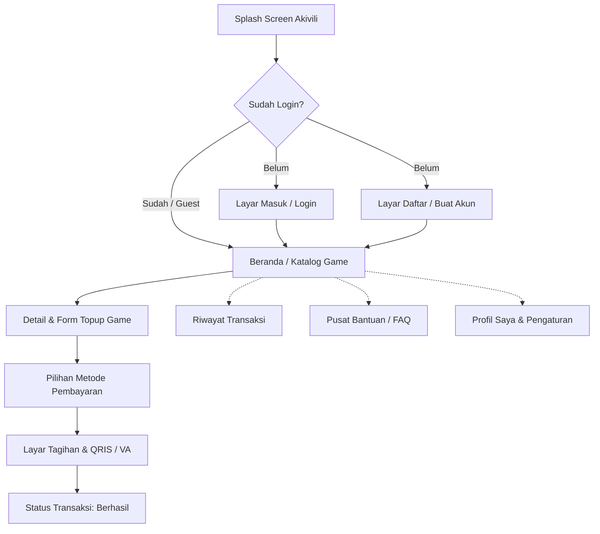

# Product Requirement Document (PRD)
## Akivili - Aplikasi Mobile Top-up Game

| Dokumen | Keterangan |
| :--- | :--- |
| **Nama Produk** | Akivili Mobile Top-up App |
| **Platform** | Android (Native - Kotlin) |
| **Versi Dokumen** | 1.0.0 |
| **Tanggal Pembuatan** | Oktober 2026 |
| **Status** | Approved for Development Planning |
| **Figma Reference** | [Akivili - APK Topup (Figma Design)](https://www.figma.com/design/VMvag1yybSv7ahGtPNeW1W/Akivili--APK-Topup-?node-id=0-1&m=dev&t=DhJmbvX0nuBMh757-1) |

---

## 1. Ringkasan Eksekutif & Latar Belakang

### 1.1 Visi Produk
**Akivili** adalah aplikasi mobile berbasis Android yang dirancang khusus untuk mempermudah gamer dalam melakukan pembelian mata uang dalam game (voucher/top-up game) secara cepat, aman, transparan, dan terpercaya. Nama *Akivili* terinspirasi dari semangat eksplorasi dan petualangan, memberikan antarmuka yang ramah pengguna, proses checkout ringkas (tanpa friksi), serta metode pembayaran lokal Indonesia yang lengkap (QRIS, E-Wallet, dan Virtual Account Bank).

### 1.2 Target Pengguna (User Persona)
1. **Gamers Kasual & Kompetitif**: Pengguna yang membutuhkan pengisian diamond/kristal game instan saat sedang push-rank atau event gacha terbatas.
2. **Pengguna Mobile-First di Indonesia**: Mengandalkan pembayaran via QRIS, DANA, GoPay, OVO, ShopeePay, serta Virtual Account m-Banking.
3. **Reseller / Buyer Rutin**: Pengguna yang membutuhkan pencatatan riwayat transaksi yang rapi dan invoice yang dapat dibagikan.

---

## 2. Analisis & Review UI/UX Desain Figma

Berdasarkan inspeksi mendalam terhadap kanvas desain Figma **`Akivili (APK Topup)`**, sistem antarmuka memiliki karakteristik desain yang konsisten sebagai berikut:

### 2.1 Identitas Visual & Design System
* **Primary Color**: Warm Amber / Bright Orange (`#F59E0B` / `#FFA000` / `#FF9800`) memberikan kesan energik, gaming, dan ramah.
* **Secondary / Accent Color**: Dark Slate / Carbon (`#1E293B`, `#0F172A`) untuk tipografi dan kartu kontras tinggi.
* **Background Colors**:
  * Screen Background: Soft Warm Gray / White (`#FAFAFA` / `#FFFFFF`).
  * Card Surfaces: White (`#FFFFFF`) dengan border radius halus (12dp–16dp) dan drop shadow tipis.
* **Status Colors**:
  * Success / Berhasil: Emerald Green (`#10B981`)
  * Pending / Menunggu: Amber (`#F59E0B`)
  * Failed / Batal: Crimson Red (`#EF4444`)
* **Typography**: Clean Modern Sans-Serif (Inter / Poppins / Roboto) dengan hierarki teks yang tegas (Header, Subtitle, Section Label, Caption).

```
                      [ PALET WARNA UTAMA ]
┌─────────────────┬─────────────────┬─────────────────┬─────────────────┐
│  Primary Amber  │  Dark Charcoal  │  Surface Light  │  Success Green  │
│     #FFA000     │     #1E293B     │     #F8FAFC     │     #10B981     │
└─────────────────┴─────────────────┴─────────────────┴─────────────────┘
```

### 2.2 Inventaris Layar (Screen Breakdown) dari Figma
Kanvas Figma membagi arsitektur alur ke dalam modul-modul berikut:



1. **Onboarding & Autentikasi**:
   * *Splash Screen*: Background penuh warna signature oranye dengan logo "Akivili." di tengah.
   * *Register Screen*: Form pendaftaran (Username, Email, No. HP, Password, Konfirmasi Password).
   * *Login Screen*: Input kredensial (Email/Username dan Password), tombol toggle password visibility, pintasan "Lupa Password", dan tautan pendaftaran.
   * *Forgot Password & OTP Verification*: Input email pemulihan, layar verifikasi kode OTP 6-digit, serta formulir set ulang kata sandi baru.
2. **Beranda (Home / Discovery Screen)**:
   * *Top App Bar*: Logo Akivili di sisi kiri, kolom pencarian (search bar), dan ikon notifikasi lonceng di sisi kanan.
   * *Carousel Banner Promosi*: Slider dinamis untuk promo cashback, event game terbaru, atau diskon musiman.
   * *Katalog Game Populer*: Grid 3 kolom dengan kartu game menarik (Honkai: Star Rail, Genshin Impact, Mobile Legends, Free Fire, Valorant, PUBG Mobile, Call of Duty, Steam Wallet, Google Play Voucher, dll.).
   * *Bottom Navigation Bar*: 4 menu utama: Beranda, Riwayat, Bantuan, dan Akun/Profil.
3. **Detail & Formulir Pemesanan Game (Top-up Order Flow)**:
   * *Game Header Card*: Banner judul game, developer/publisher, dan panduan pengisian ID.
   * *Langkah 1: Input Data Akun*: Field input User ID dan Server/Zone ID (dilengkapi tooltip/tombol modal panduan cara melihat User ID di game terkait).
   * *Langkah 2: Pilih Nominal Top-up*: Grid kartu pilihan denominasi (contoh: 86 Diamonds, 172 Diamonds, Twilight Pass, Monthly Pass, Oneiric Shards, Genesis Crystals) beserta harga mata uang Rupiah.
   * *Langkah 3: Input Kupon / Promo*: Input field opsional untuk kode voucher diskon.
   * *Sticky Bottom Bar*: Ringkasan total biaya & Tombol CTA "Beli Sekarang".
4. **Metode Pembayaran (Payment Gateway Selector)**:
   * Pilihan kategori: QRIS (Semua E-Wallet/m-Banking), E-Wallet (GoPay, OVO, DANA, ShopeePay), Transfer Virtual Account (BCA, Mandiri, BRI, BNI).
   * Menampilkan biaya layanan (admin fee) secara transparan.
5. **Tagihan & Layar QRIS (Invoice & Payment Instructions)**:
   * Countdown timer batas waktu pembayaran (misal: 15:00 menit).
   * Tampilan gambar QR Code (QRIS) dinamis yang dapat di-scan atau diunduh ke galeri.
   * Rincian tagihan: Nomor Pesanan, Item Game, User ID & Server, Total Pembayaran.
   * Tombol "Cek Status Pembayaran" & "Salin Kode / Unduh QR".
6. **Riwayat Transaksi (Transaction History)**:
   * Tab filter status: `Semua`, `Menunggu Pembayaran`, `Berhasil`, `Dibatalkan`.
   * Card item ringkas dengan thumbnail game, tanggal transaksi, nominal, dan badge status berwarna.
7. **Pusat Bantuan & Profil Pengguna**:
   * Halaman profil dengan data akun, nomor telepon, dan status tier member.
   * Menu Pengaturan, Keamanan Akun, FAQ/Pusat Bantuan, Kontak Layanan Pelanggan (WhatsApp CS), Syarat & Ketentuan, serta Kebijakan Privasi.

---

## 3. Alur Pengguna (User Journey)

### 3.1 Alur Transaksi Pembelian Top-Up
1. **Pilih Game**: Pengguna membuka aplikasi, melihat katalog di Beranda, lalu memilih game yang dituju (misal: *Mobile Legends*).
2. **Isi Identitas Game**: Pengguna memasukkan User ID dan Zone ID. Sistem dapat memvalidasi format ID game.
3. **Pilih Denominasi**: Pengguna memilih paket nominal yang diinginkan (contoh: *257 Diamonds*).
4. **Pilih Pembayaran**: Pengguna memilih metode pembayaran yang diinginkan (misal: *QRIS*).
5. **Konfirmasi Order**: Aplikasi menampilkan modal/sheet ringkasan transaksi (Nickname Game jika tersedia, Item, Harga, Biaya Layanan, Total).
6. **Proses Pembayaran**:
   * Jika QRIS: Tampilkan QR code dinamis + countdown timer.
   * Jika Virtual Account: Tampilkan nomor VA dan tombol *Copy to Clipboard*.
7. **Penyelesaian**: Setelah pembayaran terverifikasi oleh backend/webhook payment gateway, status transaksi berubah menjadi `Berhasil` dan item masuk ke akun game pengguna.

---

## 4. Persyaratan Fungsional (Functional Requirements)

### 4.1 Modul Autentikasi & Akun (FR-AUTH)
* **FR-AUTH-01**: Pengguna dapat mendaftar akun baru menggunakan username, email valid, nomor telepon, dan password.
* **FR-AUTH-02**: Pengguna dapat login menggunakan kombinasi email/username dan password.
* **FR-AUTH-03**: Pengguna dapat melakukan reset password melalui kode OTP yang dikirimkan ke email.
* **FR-AUTH-04**: Aplikasi mendukung penyimpanan sesi token login yang aman (menggunakan EncryptedSharedPreferences / Jetpack DataStore).
* **FR-AUTH-05**: Pengguna dapat menggunakan mode *Tamu (Guest Mode)* untuk melihat katalog dan melakukan pembelian instan dengan hanya memasukkan email penerima bukti pembayaran.

### 4.2 Modul Katalog & Beranda (FR-CATALOG)
* **FR-CATALOG-01**: Menampilkan carousel banner promosi yang bergulir otomatis (auto-scroll) dan dapat diklik.
* **FR-CATALOG-02**: Menampilkan daftar game terpopuler dalam format Grid 3 kolom.
* **FR-CATALOG-03**: Fitur pencarian game (*search bar*) dengan *real-time filtering* berdasarkan nama game atau kategori (Mobile Games, PC Games, Voucher Console).

### 4.3 Modul Pemesanan Top-up (FR-ORDER)
* **FR-ORDER-01**: Input formulir fleksibel sesuai kebutuhan spesifik game:
  * Game dengan User ID + Zone ID (contoh: MLBB).
  * Game dengan User ID + Server Dropdown (contoh: Genshin Impact, Honkai: Star Rail).
  * Game dengan User ID tunggal (contoh: Free Fire).
* **FR-ORDER-02**: Menampilkan daftar nominal dalam bentuk kartu seleksi (2 kolom) dengan informasi jumlah item dan nominal harga Rupiah.
* **FR-ORDER-03**: Sistem menyorot (*highlight*) item nominal yang dipilih secara interaktif.
* **FR-ORDER-04**: Fitur validasi input: tombol "Beli Sekarang" dinonaktifkan hingga seluruh field wajib terisi dengan benar.

### 4.4 Modul Pembayaran & QRIS (FR-PAYMENT)
* **FR-PAYMENT-01**: Menampilkan daftar metode pembayaran yang didukung beserta estimasi biaya admin dan status aktif/gangguan (*maintenance*).
* **FR-PAYMENT-02**: Integrasi QRIS: Menampilkan QR code bitmap berkualitas tajam dan tombol "Unduh QR Code" untuk disimpan ke galeri perangkat.
* **FR-PAYMENT-03**: Countdown timer pembayaran (15 menit) yang otomatis membatalkan transaksi jika waktu habis.
* **FR-PAYMENT-04**: Tombol *Salin Nomor VA / Kode Bayar* dengan notifikasi Toast / Snackbar feedback.
* **FR-PAYMENT-05**: Polling / WebSocket untuk memantau status pembayaran secara otomatis tanpa harus me-refresh layar secara manual.

### 4.5 Modul Riwayat Transaksi (FR-HISTORY)
* **FR-HISTORY-01**: Menampilkan daftar transaksi yang pernah dilakukan oleh pengguna.
* **FR-HISTORY-02**: Tab filter status: `Semua`, `Pending`, `Berhasil`, `Gagal`.
* **FR-HISTORY-03**: Detail transaksi menyajikan invoice digital lengkap: ID Transaksi, waktu pembayaran, status, rincian biaya, serta nomor referensi backend.

---

## 5. Persyaratan Non-Fungsional (Non-Functional Requirements)

* **Performa**: Waktu transisi antar layar < 300ms, cold startup time aplikasi < 2 detik.
* **Keamanan**:
  * Komunikasi jaringan wajib menggunakan HTTPS dengan SSL Pinning.
  * Penyimpanan data kredensial dan token menggunakan Android Keystore & EncryptedSharedPreferences.
* **Kompatibilitas**:
  * Minimum SDK: Android 7.0 (API Level 24) untuk menjangkau >95% perangkat aktif.
  * Target SDK: Android 14/15 (API Level 34/35).
* **Responsivitas UI**: Tata letak adaptif terhadap berbagai ukuran layar smartphone (rasio 16:9, 18:9, 20:9) dengan Safe Area insets (Status bar & Navigation bar edge-to-edge).

---

## 6. Arsitektur Teknis Rekomendasi (Android Kotlin)

Sesuai standar modern Android Development, proyek direkomendasikan dibangun dengan arsitektur **Clean Architecture + MVVM (Model-View-ViewModel)** berbasis **Jetpack Compose**:

```
app/
 ├── data/
 │    ├── local/          # Room DB, DataStore, Entities, DAOs
 │    ├── remote/         # Retrofit API Services, DTOs, Interceptors
 │    └── repository/     # Implementasi Repository
 ├── domain/
 │    ├── model/          # Pure Kotlin Domain Models
 │    ├── repository/     # Interface Repository (Abstraksi)
 │    └── usecase/        # Use Cases / Interactors bisnis spesifik
 ├── presentation/
 │    ├── common/         # Reusable UI Components (TopBar, Buttons, Badges)
 │    ├── theme/          # Color.kt, Type.kt, Theme.kt (Design Tokens)
 │    ├── auth/           # LoginScreen, RegisterScreen, ForgotPasswordScreen
 │    ├── home/           # HomeScreen, GameCatalogScreen
 │    ├── topup/          # TopupScreen, DenominationGrid, AccountInputForm
 │    ├── payment/        # PaymentMethodScreen, QRISInvoiceScreen
 │    ├── history/        # HistoryScreen, InvoiceDetailScreen
 │    └── profile/        # ProfileScreen, HelpCenterScreen
 └── di/                  # Hilt Dependency Injection Modules
```

### 6.1 Tech Stack Pilihan
* **Bahasa**: Kotlin 2.0+
* **UI Toolkit**: Jetpack Compose dengan Material 3
* **Arsitektur**: Clean Architecture + MVVM + Unidirectional Data Flow (UDF)
* **Asynchronous & Reaktif**: Kotlin Coroutines & StateFlow / SharedFlow
* **Dependency Injection**: Google Hilt
* **Jaringan (Networking)**: Retrofit 2 + OkHttp 3 + Kotlinx Serialization
* **Penyimpanan Lokal**: Room Database (cache transaksi & game) + Jetpack DataStore (preferensi pengguna & auth token)
* **Pemuatan Gambar (Image Loading)**: Coil 3
* **Pembuat QR Code**: ZXing Android Embedded atau Core QRGEncoder

---

## 7. Model Data Utama (Kotlin Data Entities)

```kotlin
// Data model game
data class Game(
    val id: String,
    val title: String,
    val publisher: String,
    val imageUrl: String,
    val bannerUrl: String,
    val requiresServerId: Boolean,
    val serverList: List<String>? = null,
    val inputHint: String = "Masukkan User ID Anda"
)

// Data model paket denominasi
data class TopupPackage(
    val id: String,
    val gameId: String,
    val name: String,          // contoh: "86 Diamonds"
    val price: Long,           // contoh: 20000
    val bonus: String? = null, // contoh: "+ 8 Bonus"
    val iconUrl: String? = null
)

// Data model metode pembayaran
data class PaymentMethod(
    val code: String,          // "QRIS", "GOPAY", "BCA_VA"
    val name: String,          // "QRIS (Semua E-Wallet & Bank)"
    val category: PaymentCategory, // QRIS, EWALLET, VIRTUAL_ACCOUNT
    val adminFee: Long,
    val logoUrl: String,
    val isAvailable: Boolean = true
)

// Data model transaksi
data class TopupTransaction(
    val invoiceId: String,
    val gameId: String,
    val gameTitle: String,
    val packageItem: TopupPackage,
    val targetUserId: String,
    val targetServerId: String?,
    val paymentMethod: PaymentMethod,
    val totalAmount: Long,
    val qrisPayload: String?,   // String isi QRIS jika menggunakan QRIS
    val paymentDeadline: Long,  // Unix timestamp
    val status: TransactionStatus, // PENDING, SUCCESS, FAILED, EXPIRED
    val createdAt: Long
)
```

---

## 8. Jadwal & Tahapan Pengembangan (Milestone Roadmap)

| Tahap | Lingkup Pekerjaan | Estimasi Output |
| :--- | :--- | :--- |
| **Sprint 1** | Inisialisasi Android Studio, Setup Hilt, NavHost, Design Tokens (Colors, Typography, Theme), Layar Splash & Autentikasi (Login/Register). | Project Skeleton & Auth Flow jalan |
| **Sprint 2** | Pembuatan Beranda (Carousel Banner, Grid Game 3-kolom), Bottom Navigation Bar, dan Halaman Detail Game dengan Form Input ID. | Home & Game Details Interactive |
| **Sprint 3** | Komponen Grid Denominasi, Layar Seleksi Metode Pembayaran, Layar Tagihan QRIS dengan Countdown Timer & Generator QR Code. | Top-up & Payment Checkout Flow Complete |
| **Sprint 4** | Layar Riwayat Transaksi (Tab Filter), Layar Profil & Pusat Bantuan (FAQ & WhatsApp CS), Room DB Caching, Validasi & Testing. | Fitur Lengkap & Siap Rilis APK v1.0 |
